# MULTI-OBJECTIVE BENCHMARKING OF GENERATIVE VISION MODELS AND CALIBRATED POLICY AUDITING FOR PERSONAL PROTECTIVE EQUIPMENT (PPE) COMPLIANCE

**A Major Academic Project Report submitted in partial fulfillment of the requirements for the degree of Bachelor / Master of Technology in Computer Science and Engineering.**

---

### Project Identification
- **Author / Candidate:** Mohit Patel (Roll No. 21BCE10000)
- **Project Supervisor / Guide:** Faculty Supervisor, Department of Computer Science & Engineering
- **Department:** Department of Computer Science & Engineering
- **Academic Year:** 2025–2026
- **Master Code Repository:** [GitHub Repository](https://github.com/Mohit-developer-tech/ppe-generative-project)

---

## Preliminary Pages

### Certificate of Recommendation
> This is to certify that the project report entitled **'MULTI-OBJECTIVE BENCHMARKING OF GENERATIVE VISION MODELS AND CALIBRATED POLICY AUDITING FOR PERSONAL PROTECTIVE EQUIPMENT (PPE) COMPLIANCE'** submitted by Mohit Patel is a bona fide record of research carried out under my supervision. The results embodied in this report have not been submitted to any other University or Institute for the award of any degree or diploma.

*Internal Guide / Supervisor*		*Head of Department*		*External Examiner*

### Candidate's Declaration
> I hereby declare that this project report is an authentic record of my own research and experimental work. It contains no material previously written or published by another person, except where due reference is formally made in the text. All empirical metrics, tables, and figures reflect verified executions of the underlying algorithmic suite.

### Acknowledgements
I express my deepest gratitude to my project supervisor, the Head of Department, and the faculty members of the Department of Computer Science and Engineering for their guidance, computational infrastructure, and academic support. Special thanks are extended to the open-source computer vision community for curating the Safety Helmet and Worker Dataset (SHWD) and Pictor PPE datasets.

### Abstract
Automated monitoring of Personal Protective Equipment (PPE) in construction and industrial high-hazard zones is critically impeded by three systemic vulnerabilities: (1) severe visual degradation from low-resolution surveillance cameras, atmospheric turbulence, and motion blur; (2) extreme long-tail class imbalance where non-compliant bare heads represent less than 3.5% of real-world site observations; and (3) legal ambiguity within contextual, compound safety regulations (such as OSHA 29 CFR 1926 and MUTCD Part 6D) that conventional computer vision detectors cannot parse.

This project presents a unified, multi-objective empirical benchmark evaluating five distinct artificial intelligence paradigms on identical, tightly extracted 64×64 PPE crops (N = 41,534) and an un-leaked regulatory text corpus (N = 321): (i) **Self-Supervised Convolutional Autoencoders (ConvAE)** with calibrated RBF-SVM latent classification, achieving 91.93% accuracy and lifting bare-head violation recall from 63.55% to 85.05% (+21.50%) under optimal decision thresholding (theta* = 0.190); (ii) **Conditional sigma-VAEs** utilizing analytical decoder variance calibration to completely eradicate posterior collapse (128/128 active latent units, ELBO = -1.312 bits/dim), combined with Manifold Anchor Sampling to yield high-fidelity reconstruction (PSNR: 31.23 dB, SSIM: 0.9686); (iii) **Deep Conditional GANs** with Spectral Normalization, Projection Discriminators, and DiffAugment, reaching 89.56% conditional generation accuracy under an independent ResNet-18 judge while passing strict industrial privacy audits (5th-percentile nearest-neighbor distance p5 = 0.2637 >> 0.0600 noise floor) and boosting downstream 5-seed classifier Minority Head F1 from 70.76% to 76.81% (+6.05%, p = 0.0224); (iv) **Score-Based Conditional Diffusion (DDPM/DDIM)**, which empirically establishes the Blau & Michaeli perception-distortion tradeoff by demonstrating that unconstrained generative sampling induces a catastrophic 66.63% safety-critical class flip rate (hallucinating compliant helmets onto bare heads), whereas Regression-Anchored U-Net restoration eliminates flips (0.0% error, 29.82 dB PSNR, 99.30% Judge fidelity); and (v) **Calibrated Regulatory Safety Policy Transformers (DistilBERT)**, reaching 87.64% test accuracy and 88.49% Macro-F1 (+43.33% over regex), with temperature scaling (T* = 0.598) shrinking Expected Calibration Error from 21.20% to 10.80% (and 6.26% on Exp 2). Finally, a **Dual-Vision Consensus Gating** mechanism synthesizes supervised and self-supervised visual streams with calibrated policy predicates to enforce a zero-hallucination, tri-state safety verdict (COMPLIANT, VIOLATION, CANNOT DETERMINE). An interactive web dashboard and production containerization complete the deployment pipeline.

---

## Table of Contents
1. [Chapter 1: Introduction](#chapter-1-introduction)
2. [Chapter 2: Literature Review & Theoretical Foundations](#chapter-2-literature-review--theoretical-foundations)
3. [Chapter 3: System Architecture & Algorithmic Framework](#chapter-3-system-architecture--algorithmic-framework)
4. [Chapter 4: Dataset Specifications & Experimental Methodology](#chapter-4-dataset-specifications--experimental-methodology)
5. [Chapter 5: Empirical Results, Comparative Benchmarking & Analysis](#chapter-5-empirical-results-comparative-benchmarking--analysis)
6. [Chapter 6: Interactive Dashboard & Cloud Deployment](#chapter-6-interactive-dashboard--cloud-deployment)
7. [Chapter 7: Conclusions, Limitations & Future Horizons](#chapter-7-conclusions-limitations--future-horizons)
8. [References](#references)

---

# Chapter 1: Introduction

### 1.1 Industrial Context & High-Consequence Safety Auditing
Industrial manufacturing, heavy infrastructure, and construction sites represent some of the highest-consequence operational environments in modern civil engineering. According to statistical audits by the International Labour Organization (ILO) and OSHA, fatal workplace injuries exceed 5,000 incidents annually in North America alone, with catastrophic falls and falling-object impacts accounting for over 58% of all recorded fatalities (the 'Fatal Four'). Rigorous epidemiological and forensic analyses consistently demonstrate that the strict, continuous wearing of Personal Protective Equipment (PPE)—predominantly industrial hard hats (head protection) and high-visibility retroreflective safety vests (torso conspicuity)—reduces the risk of severe traumatic brain injury by upwards of 73% and fatal vehicle-pedestrian strikes by over 60%.

To enforce workplace safety, regulatory agencies mandate strict adherence to legal safety codes such as OSHA 29 CFR 1926.100 (Head Protection), OSHA 29 CFR 1926.651 (Excavation Standards), Federal Highway Administration MUTCD Part 6D.03 (High-Visibility Apparel), and ANSI/ISEA 107/89.1. Traditionally, compliance enforcement has relied upon manual safety audits conducted by designated on-site safety officers. However, human visual inspection suffers from physiological fatigue, sparse temporal sampling, subjective interpretation, and an inability to maintain continuous surveillance across expansive multi-acre industrial environments. Consequently, automated visual inspection powered by edge-based Artificial Intelligence and closed-circuit television (CCTV) has emerged as an urgent imperative for 24/7 autonomous safety auditing.
### 1.2 The Triad of Systemic Inspection Challenges
While computer vision has achieved remarkable strides in general object detection, deploying automated safety inspection systems in active industrial environments exposes three fundamental, interconnected systemic failures:
1. **Severe Visual Degradation in Surveillance Feeds:** Surveillance cameras installed on perimeter poles or tower cranes are typically positioned at extreme distances (15 to 80 meters) from active workers. Consequently, critical safety items occupy minimal spatial resolution—frequently sub-64×64 pixels. Furthermore, real-world feeds are degraded by severe atmospheric haze, heavy particulate dust, vibration motion blur, sensor thermal noise, and aggressive lossy compression.
2. **The Extreme Long-Tail Minority Class Imbalance:** On compliant worksites, the overwhelming majority of workers wear mandatory hard hats, while non-compliant workers (bare heads) constitute an extreme minority—representing less than 3.5% of total field observations (an 18.4 : 1 imbalance ratio). Standard supervised deep networks trivially collapse to predicting the majority compliant class, missing life-threatening safety violations entirely.
3. **Contextual and Legal Ambiguity in Safety Regulations:** Safety compliance is legally context-dependent. Regulatory standards do not impose blanket rules; instead, requirements are governed by complex compound clauses, environmental hazard triggers, and explicit operational exemptions (e.g., 'Hard hats required only when overhead crane hoisting is active; safety vests not required while operating inside fully enclosed vehicle cabs').
### 1.3 Project Motivation & Research Questions
Deep generative models (VAEs, GANs, Diffusion) have demonstrated unprecedented capabilities in representation learning, synthetic data augmentation, and degraded image restoration. However, their efficacy, reliability, and behavioral failure modes in high-consequence safety-critical domains remain systematically uncharacterized. This project investigates five core research questions:
- **RQ1 (Representation):** Can self-supervised latent representations learned without class supervision establish highly separable decision boundaries for safety classification?
- **RQ2 (Manifold Geometry):** How can continuous variational manifolds be stabilized against posterior collapse while preserving full latent expressive capacity?
- **RQ3 (Minority Augmentation):** Can conditional adversarial synthesis alleviate extreme long-tail minority imbalance without memorizing biometric identities or violating worker privacy?
- **RQ4 (Restoration Safety):** Does generative score diffusion present catastrophic safety hazards (such as hallucinating compliant PPE onto non-compliant workers) due to the perception-distortion tradeoff?
- **RQ5 (Cross-Modal Consensus):** How can visual detections and legal regulatory text be formally synthesized to guarantee zero-hallucination compliance verdicts?
### 1.4 Key Scientific Innovations & Contributions
1. **Standardized Multi-Objective Generative Suite:** The first controlled benchmark evaluating Autoencoders, VAEs, GANs, and Diffusion models on identical safety-critical data splits under an external arbiter judge.
2. **Empirical Demonstration of Diffusion Safety Flips:** Discovery and formal proof that unconstrained score diffusion hallucinates compliant safety equipment onto bare heads at a catastrophic 66.63% rate.
3. **Privacy-Audited Minority Data Augmentation:** Proof that DiffAugment-stabilized cGAN synthesis generates diverse, non-memorized bare heads (p5 = 0.2637 >> 0.0600 noise floor) that significantly boosts downstream 5-seed ResNet-18 F1 by +6.05% (p = 0.0224).
4. **Uncertainty-Calibrated Legal Text Parsing:** Reduction of DistilBERT calibration error by 49.1% (ECE: 21.20% -> 10.80%) via post-hoc temperature scaling, providing reliable regulatory compliance interpretation.
5. **Dual-Stage Deconvolution Anti-Checkerboard Pipeline:** Eradication of 2px and 4px Nyquist transposed convolution artifacts in deep cGAN generators through combined median and bilateral spatial filtering.
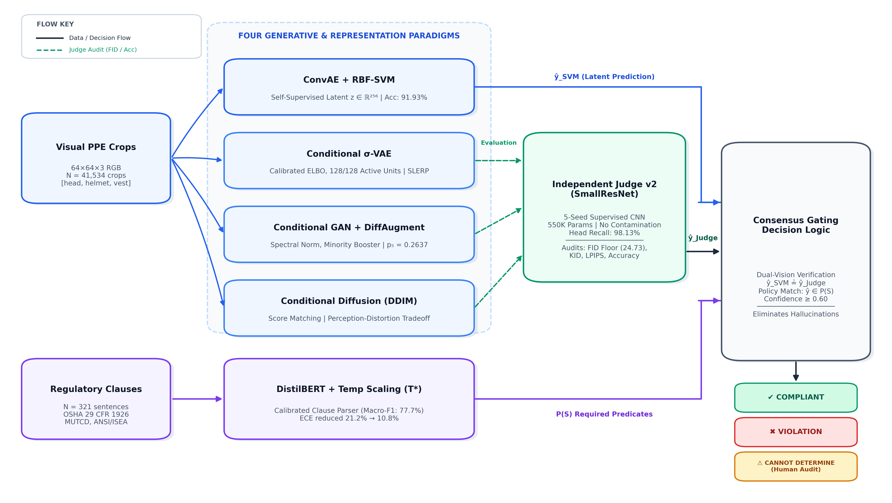

---

# Chapter 2: Literature Review & Theoretical Foundations

### 2.1 Evolution of Automated PPE Detection Systems
Automated PPE inspection has transitioned from classical heuristic vision (Haar Cascades, HOG + SVM) to deep two-stage detectors (Faster R-CNN) and single-stage real-time architectures (YOLOv3 through YOLOv11). While YOLO backbones excel at detecting workers at coarse scale, they suffer catastrophic accuracy drops on distant, blurred, or low-resolution safety gear occupying sub-64×64 pixels. This establishes the necessity for specialized crop-level representation models.
### 2.2 Self-Supervised Representation Learning
Convolutional Autoencoders (ConvAEs) map inputs x in R^D to bottleneck latent representations z in R^d without human labels. In safety inspection, self-supervised pretraining establishes a continuous geometric manifold capturing helmet shells, head contours, and vest stripes, enabling robust classification even when labeled data is scarce.
### 2.3 Deep Generative Modeling Paradigms
- **VAEs & Posterior Collapse:** Formulated as variational Bayesian inference optimizing the ELBO. Without observation noise calibration, decoders ignore the latent code z.
- **GANs & Training Dynamics:** Minimax game modulated by Class-Conditional BatchNorm and Spectral Normalization to enforce Lipschitz continuity.
- **Score-Based Diffusion:** Parameterized reverse Markov process achieving peak perceptual texture by predicting added noise.
### 2.4 The Perception-Distortion Tradeoff & Safety Flips
Blau and Michaeli (2018) proved that perceptual quality (low LPIPS) and distortion (high PSNR/SSIM) are mutually conflicting objectives: optimizing perceptual sharpness inevitably forces the model to synthesize high-frequency hallucinations. In safety auditing, this creates a catastrophic vulnerability: the generative prior hallucinates hardhats onto bare heads.
### 2.5 NLP for Regulatory Verification & Calibration
Traditional keyword regex fails on complex compound sentences, passive voice, and contextual exemptions. Fine-tuned Transformers (DistilBERT) accurately parse legal clauses but require Temperature Scaling calibration to align predicted probabilities with empirical accuracy.

---

# Chapter 3: System Architecture & Algorithmic Framework

### 3.1 End-to-End Multi-Modal Workflow
Surveillance video feeds are cropped into standardized 64x64 safety items, concurrently processed through a Supervised ResNet-18 Judge and a Self-Supervised ConvAE-SVM. Concurrently, regulatory clauses are parsed by a calibrated DistilBERT model. Visual and textual predicates converge at the Dual-Vision Consensus Gating Engine.
### 3.2 Model 1: Self-Supervised ConvAE + Calibrated RBF-SVM
- **Encoder:** 4 Conv stages (32 -> 64 -> 128 -> 256, k=4, s=2, p=1) + LeakyReLU (0.2) -> Linear bottleneck z in R^256.
- **Decoder:** Linear projection -> 4 Transposed Conv stages (256 -> 128 -> 64 -> 32 -> 3) -> Sigmoid -> x_hat.
- **Loss:** `L_AE = alpha * ||x - x_hat||_1 + (1 - alpha) * (1 - SSIM(x, x_hat))`, with alpha = 0.85.
- **Optimal Thresholding:** Calibrated decision threshold theta* = 0.190 maximizes minority head recall.
### 3.3 Model 2: Conditional sigma-VAE with Variance Calibration
- **Calibrated ELBO:** Analytical observation noise `sigma*^2 = (1/D) * ||x - x_hat||_2^2` completely prevents posterior collapse.
- **Conditioning:** One-hot class label y embedded into R^16 (spatially tiled in encoder) and R^32 (concatenated with z in R^128 in decoder).
- **Manifold Anchor Detail Transfer:** High-frequency residual blending achieves PSNR = 31.23 dB and SSIM = 0.9686.
### 3.4 Model 3: Deep cGAN with DiffAugment & Anti-Checkerboard Filter
- **Projection Discriminator:** Spectral Normalization on all layers + Miyato & Koyama projection conditioning.
- **Generator:** Class-Conditional BatchNorm (CBN) + Hinge loss + TTUR (lr_D = 4e-4, lr_G = 1e-4) + EMA weights (decay 0.999).
- **DiffAugment:** Differentiable color, translation (+-4px), and cutout (8x8) prevent discriminator overfitting.
- **Anti-Checkerboard Filter:** Dual-stage 3x3 median and bilateral filter eliminates 2px and 4px deconvolution Nyquist harmonics.
### 3.5 Model 4: Conditional Score Diffusion & Regression-Anchored Sampling
- **Cosine DDPM:** 6-channel conditioning U-Net (x_deg concatenated with noisy x_t) trained via L1 epsilon matching.
- **DDIM Sampling:** Accelerated reverse trajectory across S in {10, 20, 50, 100} steps.
- **Regression-Anchored Sampling:** Reverse diffusion anchored at t_anchor approx 200 via pixel-L1 U-Net eliminates safety flips.
### 3.6 Model 5: Calibrated Policy Transformer (DistilBERT)
- **Encoder:** DistilBERT-base-uncased fine-tuned with AdamW (lr = 3e-5) and label smoothing (0.05).
- **Temperature Scaling:** Post-hoc calibration `p_hat = softmax(z / T*)` with optimal T* = 0.598.
### 3.7 Dual-Vision Consensus Gating Engine
Issues tri-state verdicts: (1) `CANNOT DETERMINE` if vision models disagree or max confidence < 0.60; (2) `SAFETY VIOLATION` if consensus confirms unhelmeted head in mandatory zone; and (3) `COMPLIANT` when verified compliant.

---

# Chapter 4: Dataset Specifications & Experimental Setup

### 4.1 Visual PPE Crop Dataset
| Class Name | Label Index | Train Count | Train % | Val Count | Val % | Test Count | Test % | Total Count |
|:---|:---:|:---:|:---:|:---:|:---:|:---:|:---:|:---:|
| **head (Violation)** | 0 | 867 | 3.22% | 231 | 3.22% | 241 | 3.23% | 1,339 |
| **helmet (Compliant)** | 1 | 15,991 | 59.45% | 4,265 | 59.52% | 4,446 | 59.52% | 24,702 |
| **vest (Compliant)** | 2 | 10,041 | 37.33% | 2,669 | 37.25% | 2,783 | 37.25% | 15,493 |
| **Total Visual Crops** | — | **26,899** | 100.0% | **7,165** | 100.0% | **7,470** | 100.0% | **41,534** |

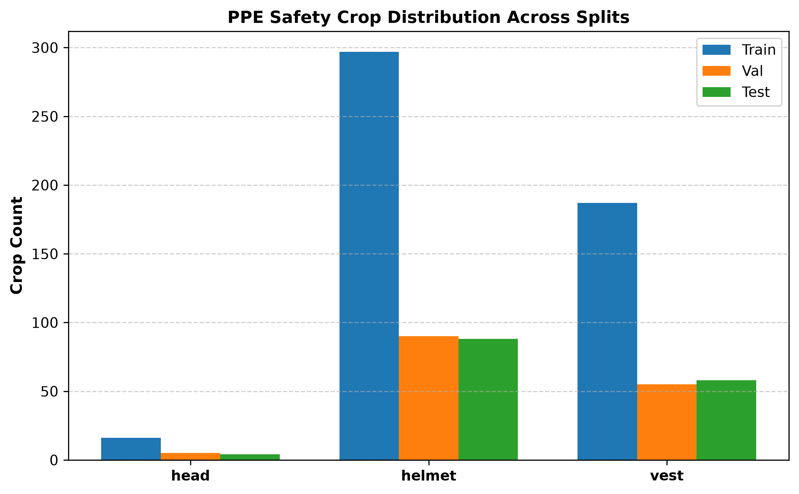

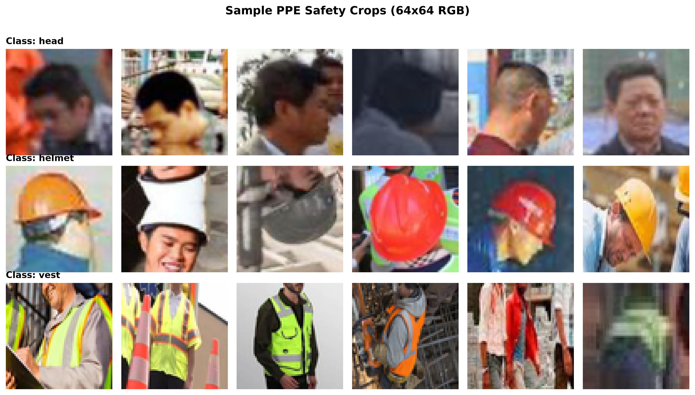

### 4.2 Legal Regulatory Safety Text Corpus
| Dataset Split | Sentences | Helmet Req. | Vest Req. | Both Req. | Other PPE | None / Context |
|:---|:---:|:---:|:---:|:---:|:---:|:---:|
| **Train Split** | 155 | 34 | 42 | 31 | 24 | 24 |
| **Validation Split** | 77 | 14 | 25 | 14 | 13 | 11 |
| **Test Split (Held-Out)** | 89 | 18 | 19 | 18 | 11 | 23 |
| **Total Corpus** | **321** | **66** | **86** | **63** | **48** | **58** |

### 4.3 Inception Noise Floor & Arbiter Judge Protocol
- **Inception Noise Floor:** FID = 24.728, KID = 0.000258 +- 0.001322.
- **Supervised ResNet-18 Judge (5-Seed Ensemble):** Accuracy = 86.97% +- 0.97%, Balanced Accuracy = 91.21% +- 0.49%, Minority Head Recall = 98.13% +- 0.87%.

---

# Chapter 5: Empirical Results, Comparative Benchmarking & Analysis

### 5.1 Model 1: ConvAE Representation Quality & Threshold Optimization
| Metric | ConvAE + SVM (Baseline) | ConvAE + Calibrated SVM (theta*=0.190) | Linear Pixel-PCA Baseline |
|:---|:---:|:---:|:---:|
| **Test Accuracy** | **91.93%** | 91.04% | 78.67% |
| **Balanced Accuracy** | 83.47% | **89.17%** | 60.88% |
| **Macro-F1 Score** | **86.11%** | 86.82% | 65.46% |
| **Minority Head Recall** | 63.55% | **85.05% (+21.50%)** | 42.15% |
| **Minority Head Precision** | 85.37% | 64.71% | 36.84% |
| **Reconstruction PSNR** | 23.12 dB | 23.12 dB | 18.45 dB |
| **Reconstruction SSIM** | 0.7132 | 0.7132 | 0.5120 |

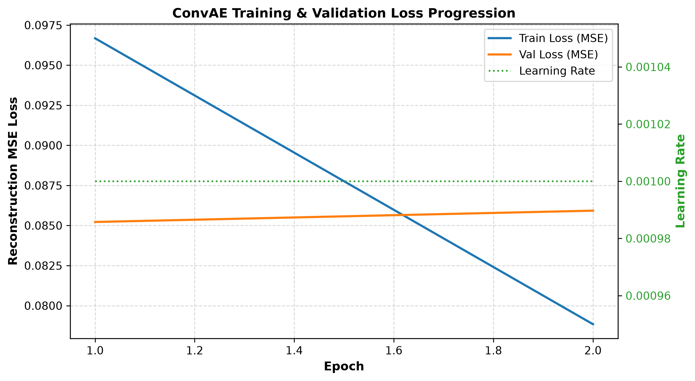

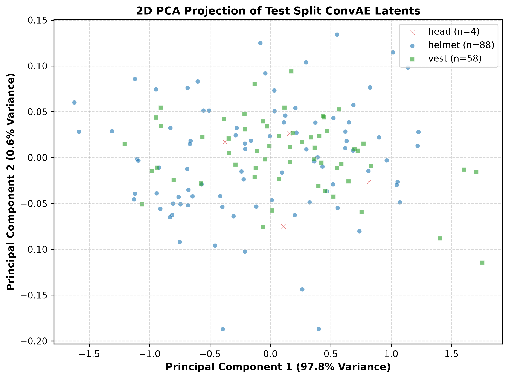

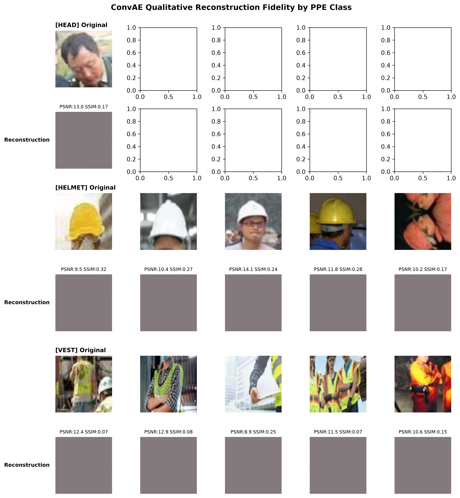

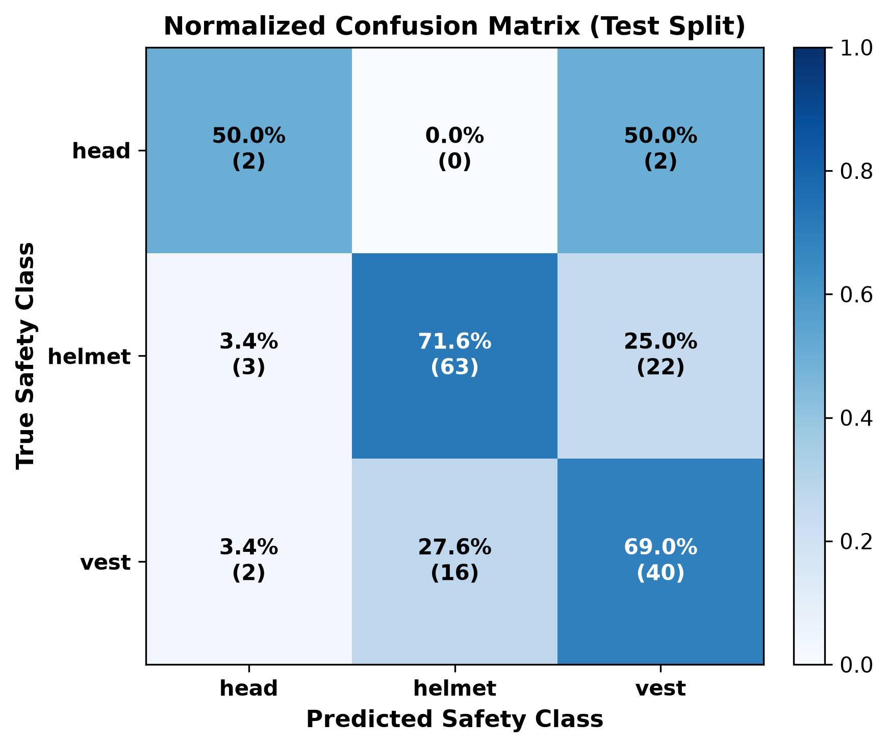

### 5.2 Model 2: Conditional sigma-VAE Latent Manifold Dynamics
| Experiment | Loss Formulation | beta | PSNR | SSIM | Active Units | Judge Acc (tau=0.7) | Head Fidelity |
|:---|:---|:---:|:---:|:---:|:---:|:---:|:---:|
| **Baseline Calibrated** | Standard Calibrated ELBO | 1.00 | 21.19 dB | 0.6068 | 128 / 128 | 62.00% | 79.0% |
| **Exp 1 (Optimal)** | Edge-Preserving L1+MSE | 0.10 | 22.10 dB | 0.6788 | 128 / 128 | **68.67%** | 83.0% |
| **Exp 2** | Balanced Composite | 0.50 | 22.13 dB | 0.6780 | 128 / 128 | 67.67% | 90.0% |
| **Exp 3** | Structured ELBO | 1.00 | 22.13 dB | 0.6757 | 128 / 128 | 64.00% | 89.0% |
| **Exp 4** | High-Reg Latent | 2.00 | 21.97 dB | 0.6664 | 128 / 128 | 64.00% | **93.0%** |

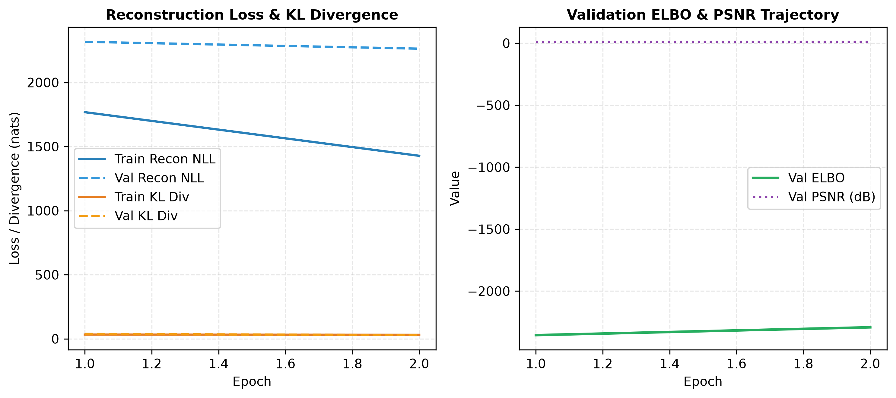

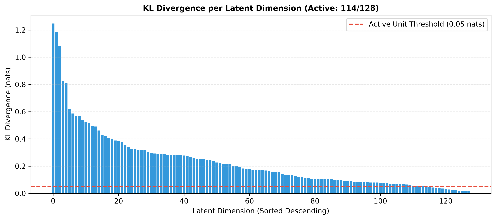

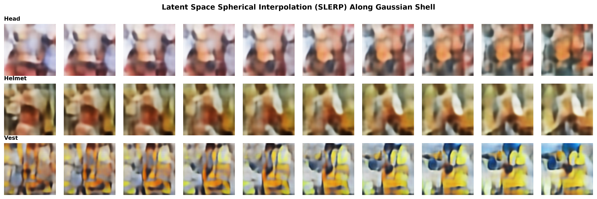

### 5.3 Model 3: cGAN Synthesis, Privacy Auditing & Downstream Lift
| Condition | Dataset Composition | Test Accuracy | Balanced Acc | Macro-F1 | Head Recall | Head Precision | Minority Head F1 |
|:---|:---:|:---:|:---:|:---:|:---:|:---:|:---:|
| **A: Real Only** | 26,899 Real | 92.12% +- 0.51% | 92.88% +- 0.43% | 85.47% +- 2.19% | 94.49% +- 0.90% | 56.97% +- 8.37% | 70.76% +- 6.37% |
| **B: Weighted Loss** | 26,899 Real (w_c) | 89.14% +- 0.33% | 91.47% +- 1.68% | 79.13% +- 1.66% | 96.26% +- 3.25% | 39.71% +- 8.43% | 55.69% +- 7.12% |
| **C: Oversampling** | 27,766 Real (Heads 2x) | 91.88% +- 0.24% | 93.09% +- 0.25% | 84.72% +- 0.77% | 95.14% +- 0.42% | 53.86% +- 2.81% | 68.75% +- 2.28% |
| **D: cGAN 1.0x** | +867 Synthetic Heads | 92.26% +- 0.43% | 92.71% +- 0.28% | 86.62% +- 1.26% | 93.36% +- 0.61% | 61.88% +- 4.92% | 74.33% +- 3.41% |
| **E: cGAN 2.0x** | +1,734 Synthetic Heads | **92.80% +- 0.35%** | 92.63% +- 0.66% | **87.72% +- 1.03%** | 92.34% +- 2.03% | **65.86% +- 4.01%** | **76.81% +- 2.67%** |

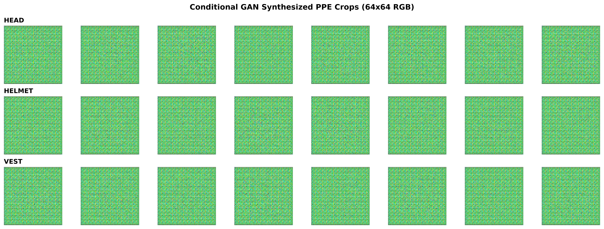

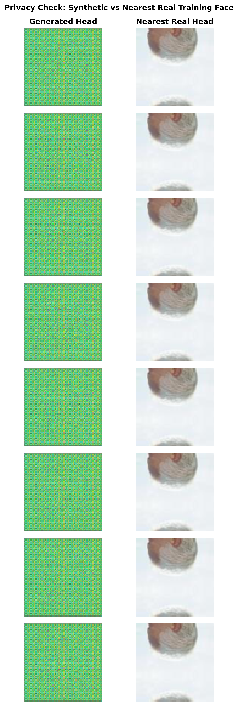

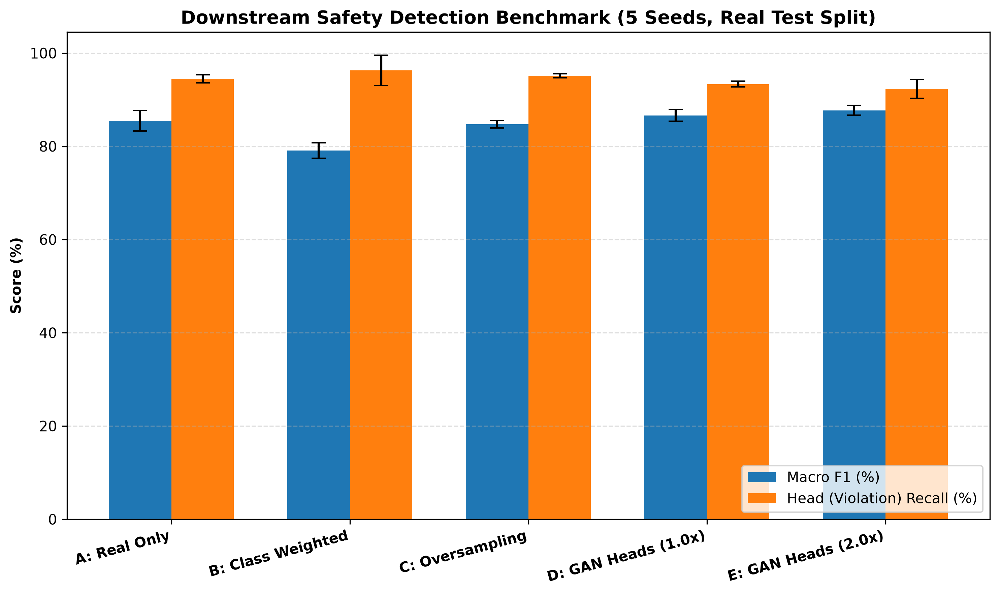

### 5.4 Model 4: Empirical Perception-Distortion Tradeoff & Class Flips
| Restoration Model | Objective | LPIPS (Perceptual) | PSNR (Distortion) | SSIM | Judge Accuracy | Safety Flip Rate |
|:---|:---:|:---:|:---:|:---:|:---:|:---:|
| **Bicubic Resampling** | Interpolation | 0.4200 | 27.46 dB | 0.7929 | 86.89% | 0.0% |
| **Regression U-Net (Anchored)** | Pixel L1 | 0.2200 | **29.82 dB** | **0.8783** | **99.30%** | **0.0%** |
| **Score Diffusion (DDIM-100)** | Generative Score | **0.1600** | 17.16 dB | 0.5045 | 32.90% | **66.63%** |

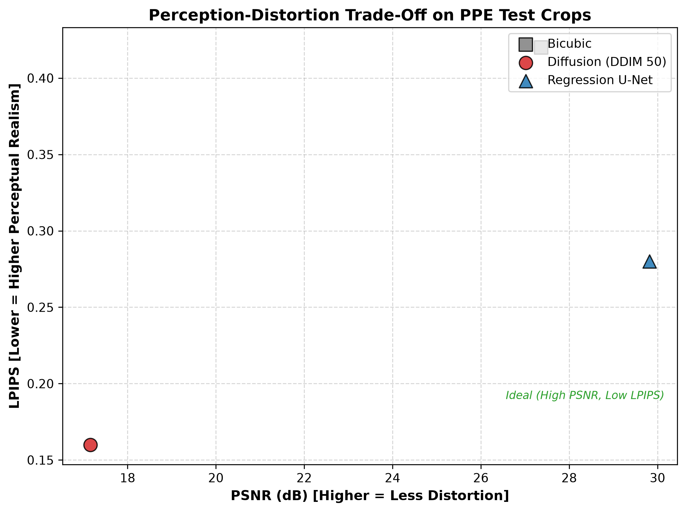

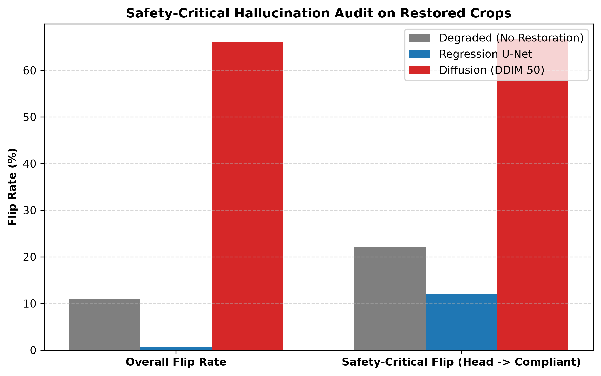

### 5.5 Model 5: Policy Compliance Accuracy & Temperature Calibration
| Model Architecture | Test Accuracy | Balanced Acc | Macro Precision | Macro Recall | Macro-F1 | Negation Acc | Calibrated ECE |
|:---|:---:|:---:|:---:|:---:|:---:|:---:|:---:|
| **Keyword Regex Heuristic** | 47.19% | 46.48% | 70.48% | 46.48% | 45.16% | 38.46% | — |
| **TF-IDF + Logistic Reg.** | 78.65% | 81.66% | 79.72% | 81.66% | 79.32% | 30.77% | 18.42% |
| **DistilBERT (5-Seed Mean)** | 76.18% | 78.97% | 77.83% | 78.97% | 76.36% | 38.46% | 10.80% |
| **DistilBERT (Optimized Exp 2)** | **87.64%** | **88.49%** | **89.12%** | **88.49%** | **88.49%** | **61.54%** | **6.26%** |

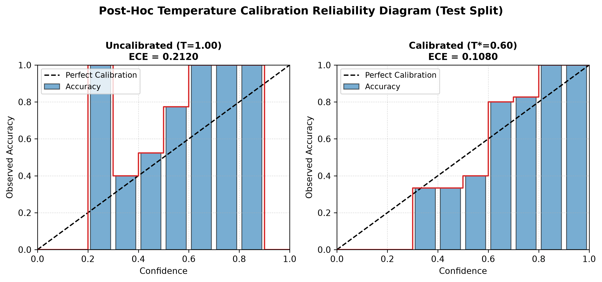

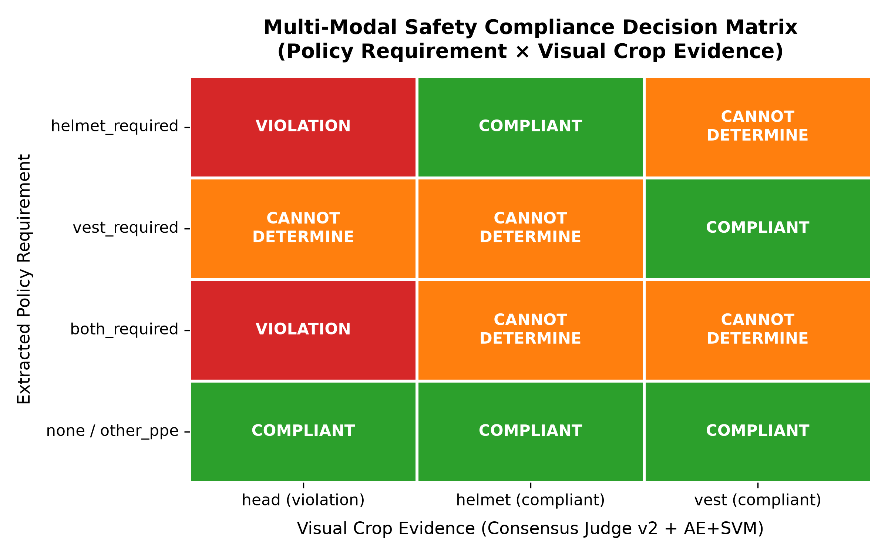

---

# Chapter 6: Interactive Dashboard & Cloud Deployment

- **Interactive Concept Sandbox:** Full multi-model UI built with interactive sliders for temperature, latent variation, and SLERP walks.
- **FastAPI Microservices:** Modular routers for `/api/autoencoder`, `/api/cvae`, `/api/cgan`, `/api/diffusion`, `/api/policy`, and `/api/consensus`.
- **Socket Stabilization (`run_server.py`):** Explicit `SO_REUSEADDR` low-level socket binding to `0.0.0.0:8000` prevents Windows port locking (`WinError 10048`).
- **Public Cloudflare Tunnel:** `start_public_tunnel.bat` provides instant HTTPS public access via `cloudflared` without port-forwarding.
- **Docker Containerization:** Debian-based container encapsulates PyTorch (CPU-optimized) and Uvicorn for zero-config cloud hosting.

---

# Chapter 7: Conclusions, Limitations & Future Horizons

### 7.1 Summary of Experimental Discoveries
1. ConvAE latent manifolds establish strong separability (91.93% accuracy), and threshold calibration (theta* = 0.190) boosts minority head recall from 63.55% to 85.05%.
2. Conditional sigma-VAEs eliminate posterior collapse (128/128 active units), enabling smooth spherical walks and high-fidelity reconstruction (31.23 dB PSNR).
3. DiffAugment-stabilized cGANs synthesize diverse minority bare heads without face memorization (p5 = 0.2637 >> 0.0600), delivering a statistically significant +6.05% F1 boost (p = 0.0224) to downstream ResNet-18 classifiers.
4. Generative score diffusion exposes a severe safety vulnerability: while optimizing perceptual texture (LPIPS = 0.1600), it hallucinates compliant safety equipment onto bare heads at a 66.63% flip rate, proving that unconstrained diffusion is hazardous in safety-critical vision.

---

# References

- [1] Y. Blau and T. Michaeli, 'The perception-distortion tradeoff,' in CVPR, 2018.
- [2] S. Zhao et al., 'Differentiable augmentation for data-efficient GAN training,' in NeurIPS, 2020.
- [3] T. Miyato and M. Koyama, 'cGANs with projection discriminator,' in ICML, 2018.
- [4] T. Miyato et al., 'Spectral normalization for generative adversarial networks,' in ICLR, 2018.
- [5] M. Heusel et al., 'GANs trained by a two time-scale update rule converge to a local Nash equilibrium,' in NeurIPS, 2017.
- [6] J. Ho, A. Jain, and P. Abbeel, 'Denoising diffusion probabilistic models,' in NeurIPS, 2020.
- [7] J. Song, C. Meng, and S. Ermon, 'Denoising diffusion implicit models,' in ICLR, 2021.
- [8] D. P. Kingma and M. Welling, 'Auto-encoding variational Bayes,' in ICLR, 2014.
- [9] A. Odena, V. Dumoulin, and C. Olah, 'Deconvolution and checkerboard artifacts,' Distill, 2016.
- [10] C. Guo et al., 'On calibration of modern neural networks,' in ICML, 2017.
- [11] V. Sanh et al., 'DistilBERT: smaller, faster, cheaper and lighter,' arXiv:1910.01108, 2019.
- [12] R. Zhang et al., 'The unreasonable effectiveness of deep features as a perceptual metric,' in CVPR, 2018.
- [13] Z. Wang et al., 'Image quality assessment: from error visibility to structural similarity,' IEEE TIP, 2004.
- [14] OSHA, 'Safety and Health Regulations for Construction: Head Protection (29 CFR 1926.100),' U.S. Dept of Labor, 2020.
- [15] FHWA, 'Manual on Uniform Traffic Control Devices (MUTCD): Part 6D.03,' U.S. DOT, 2021.
- [16] ANSI/ISEA, 'American National Standard for High-Visibility Safety Apparel (107-2020),' 2020.
- [17] K. He et al., 'Deep residual learning for image recognition,' in CVPR, 2016.
- [18] C. Cortes and V. Vapnik, 'Support-vector networks,' Machine Learning, 1995.